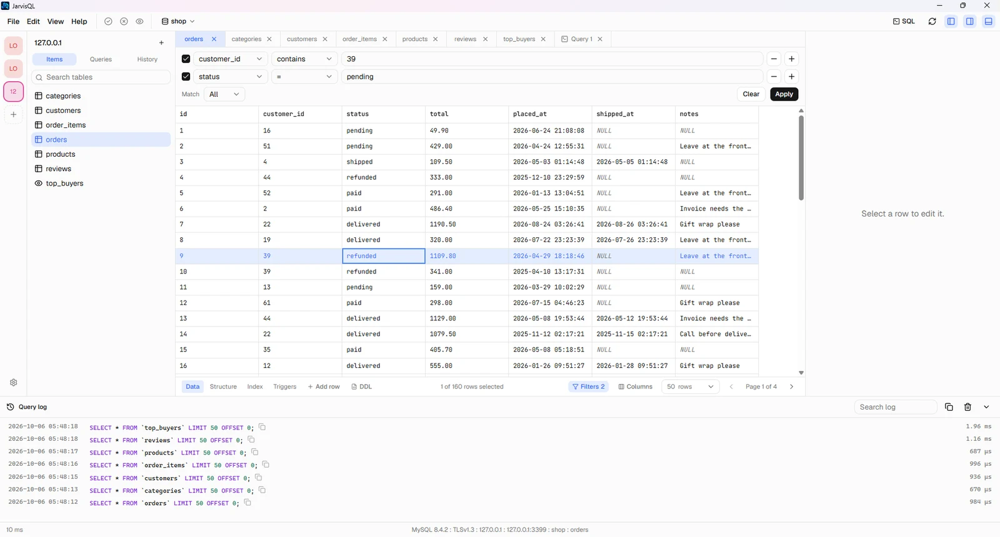

  <picture>
    <source media="(prefers-color-scheme: dark)" srcset="assets/logo-dark.png">
    
  </picture>

<h3 align="center">A fast, private desktop client for your databases.</h3>

  SQLite, MySQL and MariaDB, on your computer or on a server over SSH.

  
  
  
  

  <a href="https://github.com/fftfaisal/jarvisql-releases/releases/latest"><b>Download</b></a>
  &nbsp;·&nbsp;
  <a href="https://jarvisql.faisal.com.bd">Website</a>
  &nbsp;·&nbsp;
  <a href="RELEASE_NOTES.md">Release notes</a>

  <picture>
    <source media="(prefers-color-scheme: dark)" srcset="docs/assets/app-dark.webp">
    
  </picture>

---

### Why JarvisQL

- **Small and quick.** About 5 MB to install. Built with Rust.
- **Review before saving.** Every edit is collected first, then applied together.
- **Private.** No account and no analytics. Passwords stay in your system keychain.
- **Remote over SSH.** Password or private key, with host key checking.
- **Full editing.** Rows, table structure, indexes and database users.
- **Careful with big data.** Large files are streamed, with progress and a Cancel button.

### Supported databases

| Database | Browse and edit | Structure and indexes | Users | Over SSH |
| --- | :---: | :---: | :---: | :---: |
| SQLite | Yes | Yes | n/a | Yes |
| MySQL | Yes | Yes | Yes | Yes |
| MariaDB | Yes | Yes | Yes | Yes |
| PostgreSQL | Planned | Planned | Planned | Planned |
| SQL Server | Planned | Planned | Planned | Planned |

### Features

**Connections**
- Saved connections with groups, colors, and tags. Drag to reorder.
- SQLite files on your computer, or on a server over SSH.
- MySQL and MariaDB servers, with SSL (including CA, client certificate and key files) and connections through an SSH tunnel.
- A database picker: every database on a server opens as its own connection. Create or drop databases from it.
- Passwords and key passphrases stored in Windows Credential Manager, macOS Keychain, or the Linux Secret Service.

**Browse and edit**
- Tables and views with sorting, filters, and paging. Choose how many rows to show, and start at any row.
- Edit cells in place, add, duplicate, or delete rows, then review all pending changes before you save.
- Set a field to `NOW()`, the current date or time, or `DEFAULT` from the row editor.
- Rows are matched by primary key, big numbers stay exact, and binary cells show a hex preview.
- Structure, index, trigger, and DDL views. Change a table's columns and indexes with a preview of the SQL before it runs, and undo or redo as you go.

**Database users**
- List, create, rename, and delete MySQL and MariaDB users.
- Set passwords, host, resource limits, and access per database, from none to full.
- Review the exact SQL before anything is applied.

**SQL editor**
- Query tabs with autocomplete for tables and columns.
- Run the current statement or all of them. Every result opens in its own tab.
- Beautify, saved queries, and history for each connection.
- A query log with timings and syntax colors.

**Import and export**
- Import CSV, JSON, and SQL files.
- Export tables or whole databases as CSV, JSON, or SQL.

**And more**
- Light, dark, and system themes, with font settings.
- Updates inside the app.
- Keyboard shortcuts for the everyday actions.

### Install

| System | Download |
| --- | --- |
| Windows | `JarvisQL-x.y.z-windows-x64-setup.exe` |
| macOS, Apple silicon | `JarvisQL-x.y.z-macos-aarch64.dmg` |
| macOS, Intel | `JarvisQL-x.y.z-macos-x64.dmg` |
| Linux | `JarvisQL-x.y.z-linux-amd64.AppImage` or `.deb` |

Get the latest files from the [releases page](https://github.com/fftfaisal/jarvisql-releases/releases/latest).

The installers are not code-signed yet, so your system may ask you to confirm the first launch:

- **Windows:** if SmartScreen says "Windows protected your PC", click **More info**, then **Run anyway**.
- **macOS:** right-click the app, choose **Open**, then **Open** again.
- **Linux:** for the AppImage, make it executable first with `chmod +x`.

JarvisQL checks for new versions and installs them for you. You can also check at any time from **Help**, then **Check for updates**.

### Usage

1. Choose **New** to add a connection, or **Open file** to open a SQLite file straight away.
2. Pick the database type, fill in the details, and for a server turn on the SSH tunnel if you need one. Save it.
3. Double-click the connection, or press **Connect**.
4. Open a table from the list to browse it. Edit cells, add or delete rows, then review the pending changes and save them.
5. Open a query tab to run SQL, or use the toolbar to change a table's structure, manage users, import, or export.

### Your data

Connections, saved queries, and settings are stored in the `.jarvisql` folder in your home directory. Your databases are never copied anywhere else. For a SQLite database on a server, JarvisQL works on a temporary local copy and uploads it back only when you choose to.

### Built with

Rust and [Tauri](https://tauri.app) for the core and the database drivers, Vue and TypeScript for the interface.

### Feedback

Found a bug, or have an idea? [Open an issue](https://github.com/fftfaisal/jarvisql-releases/issues/new).
